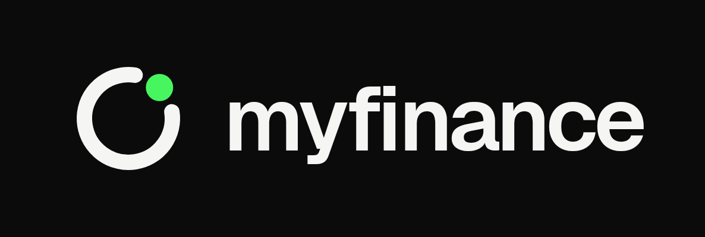
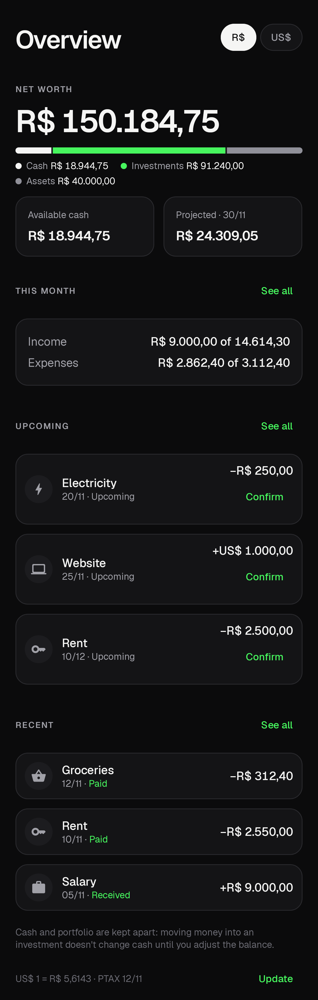
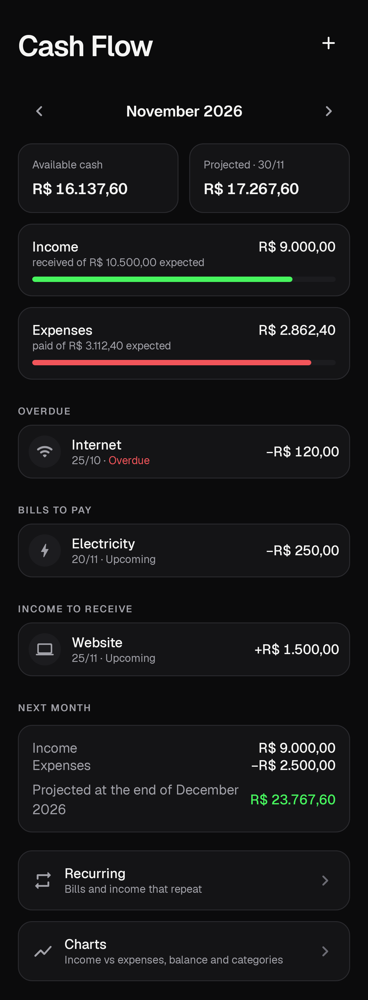
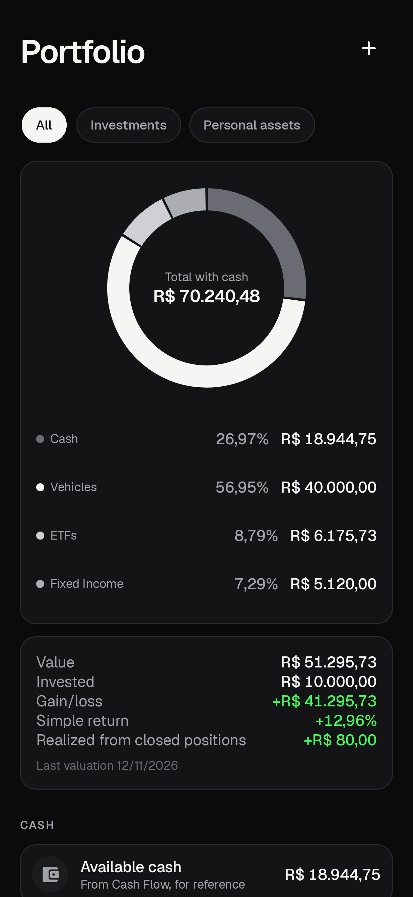
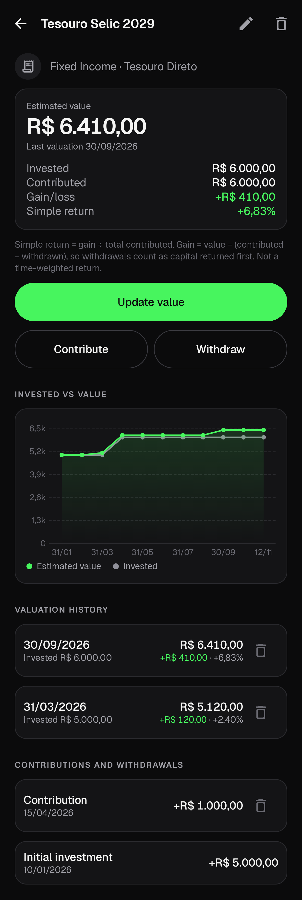
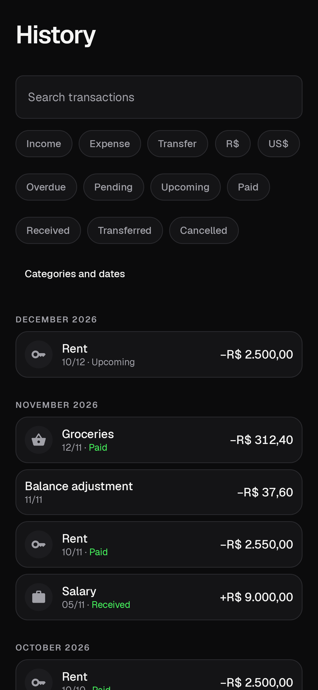
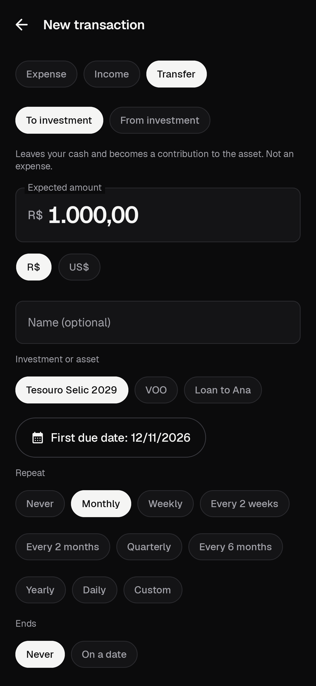
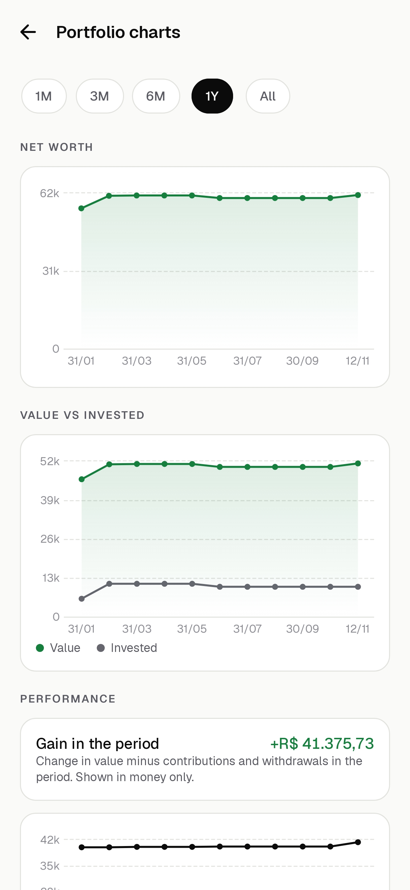
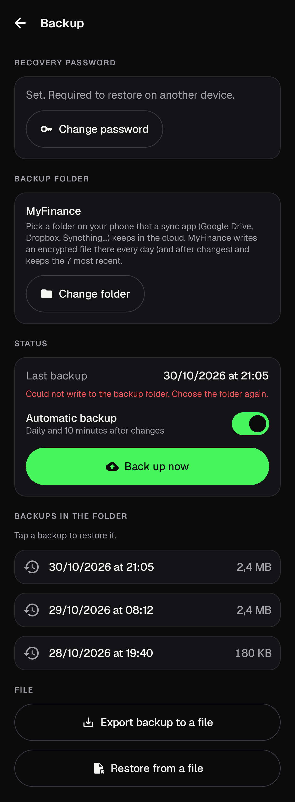

<p align="center">
  
</p>

# MyFinance

A private, offline-first Android app to manage cash flow, a portfolio of investments and personal assets, and net worth, in BRL and USD. No account, no server, no ads. Available in English and Brazilian Portuguese. [MyFit](https://github.com/luannamorim/myfit)'s sibling: same design language, same engineering standards.

## Features

- **Cash flow:** one-time and recurring income and expenses (daily, weekly, every two weeks, monthly, every two months, quarterly, semiannually, annually or custom), with month-end and leap-year handling and no duplicate occurrences. Confirm each payment or receipt with the real amount, date and a note; the expected amount stays separate and future months are untouched.
- **Month at a glance:** expected vs. received income, expected vs. paid expenses, the month's result (what is left over or short), available cash, projected end-of-month balance, overdue and pending bills, income to receive, transfers and next month's forecast. Charts for income vs. expenses, balance evolution (3, 6 or 12 months) and spending by category.
- **Transfers:** move money between cash and an investment (or back) as a transfer: one-time or recurring, confirmed like a bill, recorded on both sides at once and never counted as income or expense. Contributions, withdrawals and sales on an asset can come from or go to cash, including the initial investment.
- **History:** every transaction grouped by month, with accent-insensitive search and filters by type, status, category, currency and date.
- **Portfolio:** fixed income, stocks, ETFs, REITs, funds, crypto, business ownership, startup equity, real estate, vehicles, loans receivable and custom categories, with your available cash shown alongside for reference. Contributions, withdrawals, partial sales and closed positions are recorded apart from valuations, which keep their full history. Value, invested, gain/loss and a clearly labelled simple return; an allocation donut you can tap to filter; charts by period (1M, 3M, 6M, 1Y, All) built only from what you recorded.
- **Net worth:** cash + investments + personal assets, with the composition always visible, in reais or dollars with one tap.
- **BRL and USD:** every transaction, balance and asset has its currency. Totals convert with the official PTAX rate from the Banco Central do Brasil, fetched when you open the app or with *Update*; manual rates work offline. The rate and its date are always shown, and a total that can't be converted is marked instead of guessed.
- **Backup:** an encrypted file (AES-256-GCM streaming, key derived from your recovery password) written to a folder you pick and keep in sync with Google Drive (or any cloud) through a sync app. Runs daily and after changes, keeps the last 7, and supports export and restore with integrity checks. CSV export for spreadsheets.
- **Settings:** opening balances and balance adjustments, categories, default and display currency, number format (1.234,56 or 1,234.56), date format (DD/MM/YYYY or MM/DD/YYYY), dark (default), light or system theme.

## Screenshots

<p>
  
  
  
  
</p>
<p>
  
  
  
  
</p>

All screenshots use synthetic data.

## Install

Download the APK from [Releases](../../releases). MyFinance is not on the Play Store and is not registered with Android developer verification, which is enforced in some countries (e.g. Brazil since September 2026). Use one of these:

1. **ADB:** enable *Developer options → USB debugging* (or *Wireless debugging*), connect the phone and run `adb install -r myfinance-<version>.apk`. ADB installs are not subject to verification.
2. **Advanced flow:** in *Developer options*, allow apps from unverified developers. Android asks for a restart, a 24-hour wait and re-authentication; after that the APK installs from the file manager.

Updates are signed with the same key, so `adb install -r` (or installing over) keeps your data.

## Privacy

- Your data stays on the phone: no account, no server, no analytics, no ads.
- The only network request fetches the public USD/BRL rate from `api.bcb.gov.br` over HTTPS, carrying only a date range. Turn it off in *Settings → Currency and exchange rate*; *Update* then fetches only when you tap it.
- Backups are encrypted before they leave the app. The local database relies on Android's app sandbox and file-based encryption. Details in [`docs/SECURITY.md`](docs/SECURITY.md).

## Backup to Google Drive (or any cloud)

1. *Settings → Backup → Set password*. Keep it safe: backups cannot be restored without it.
2. Create a folder on the phone (e.g. `MyFinance Backup`) and keep it synced with your cloud using a folder-sync app.
3. *Choose folder* in MyFinance. From then on it writes `myfinance-backup-YYYYMMDD-HHmmss.myfinance` every day and a few minutes after changes, keeping the 7 most recent.
4. To restore (e.g. on a new phone): install MyFinance, sync the folder, choose it under *Backup*, tap a file, confirm the date and enter the password.

Format and recovery process: [`docs/BACKUP.md`](docs/BACKUP.md).

## Build

Requirements: JDK 21 and the Android SDK (platform 37, build-tools 37.0.0). Everything works from the command line:

```bash
export JAVA_HOME=/path/to/jdk-21 ANDROID_HOME=/path/to/Android/Sdk
echo "sdk.dir=$ANDROID_HOME" > local.properties

./gradlew assembleDebug            # debug APK (io.github.luannamorim.myfinance.debug)
./gradlew testDebugUnitTest        # tests (JVM + Robolectric)
./gradlew recordRoborazziDebug     # screenshots in app/build/outputs/roborazzi/
./gradlew lintDebug
./gradlew assembleRelease          # signed APK (needs the MYFINANCE_* properties below)
```

Release signing reads these from `~/.gradle/gradle.properties` (never commit them). Without them the release build is unsigned:

```properties
MYFINANCE_STORE_FILE=/path/to/myfinance-release.jks
MYFINANCE_STORE_PASSWORD=...
MYFINANCE_KEY_ALIAS=myfinance
MYFINANCE_KEY_PASSWORD=...
```

GitHub Actions runs the tests, lint and a debug build on every push and pull request.

## Tech stack

Kotlin 2.4 · Jetpack Compose + Material 3 (adaptive) · Navigation Compose (type-safe) · Hilt · Room · DataStore · WorkManager · Vico · Tink · kotlinx.serialization · JUnit, Robolectric and Roborazzi. A single `:app` module in layers: `ui/` → `domain/` ← `data/`, with workers in `platform/`. Money is integer minor units plus a currency; every financial calculation is pure Kotlin in `domain/` with hand-computed tests.

## Documentation

- [`SPEC.md`](SPEC.md): product specification
- [`IMPLEMENTATION_PLAN.md`](IMPLEMENTATION_PLAN.md): stages and tasks
- [`docs/ARCHITECTURE.md`](docs/ARCHITECTURE.md): architecture, data model and financial rules
- [`docs/BRAND.md`](docs/BRAND.md): visual identity
- [`docs/SECURITY.md`](docs/SECURITY.md): security model
- [`docs/BACKUP.md`](docs/BACKUP.md): backup format and recovery
- [`docs/TESTING.md`](docs/TESTING.md): automated tests and the on-device checklist
- [`CONTRIBUTING.md`](CONTRIBUTING.md): how to contribute

## License

[MIT](LICENSE). The Geist font is under the SIL Open Font License 1.1 ([`docs/licenses/GEIST_OFL.txt`](docs/licenses/GEIST_OFL.txt)). Exchange rates come from the Banco Central do Brasil's public data (SGS series 1, PTAX).
